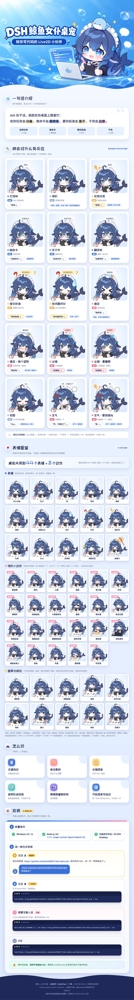

# dsh-whale-pet

**English** | [简体中文](README.zh-CN.md)

**DS whale maid girl desktop pet.** A blue-haired Live2D maid with a big whale tail who floats on your Windows desktop. When your dsh agent receives a message, gets to work, waits for your approval, hits an error or finishes, she changes expression, plays a motion and pops up a speech bubble. A native dsh plugin feeds her over a loopback HTTP endpoint (`127.0.0.1:47824`), and a bundled hook script lets Claude Code-style hooks drive her too. Windows only for now.

[](docs/intro/intro.png)

*Click the poster for the full-resolution version. It contains screenshots of the model and derived illustrations, licensed CC BY-NC-SA 4.0; see [THIRD_PARTY_NOTICES.md](THIRD_PARTY_NOTICES.md).*

<table>
<tr>
<td align="center"><br>Task done: V-sign, the little whale spouts water</td>
<td align="center"><br>Poke her: she gets angry</td>
<td align="center"><br>30 min idle: sleepy, Zzz</td>
</tr>
<tr>
<td align="center"><br>Idle act: pixel sunglasses</td>
<td align="center"><br>Idle act: bubble gum</td>
<td align="center"><br>Idle act: omelette rice with ketchup</td>
</tr>
</table>

## What she reacts to

She is not decoration: she is dsh's "work status light". The dsh plugin translates runtime events into "pet events" and sends them to her. Here is how dsh events map to pet events (based on the dsh 0.2.1 runtime events):

| Pet event | dsh event |
|---|---|
| `SessionStart` | `agent/created` (root agent) |
| `UserPromptSubmit` | `user/message` inside `session/event`; automatic wake-ups with no user message are covered by `agent/status running` |
| `PreToolUse` / `PostToolUse` | `tools/pre-execute` / `tools/post-execute` (carry `tool_name`; tools of sub-agents are merged into the root session) |
| `Stop` | `agent/status idle` (root agent) |
| `SubagentStart` / `SubagentStop` | `subagent/start` / `subagent/end` |
| `WaitingApproval` | `approval/request` (waiting for your approval) |
| `WaitingAnswer` | `user-questions/request` (waiting for your answer) |
| `Resume` | after the two requests above have been answered (with several in parallel, only after all are answered) |
| `Error` | `agent/error` (the final failure after retries are exhausted; `agent/request-error`, which retries automatically, is not reported) |

### State machine

State is tracked per session (`session_id`). When several sessions are merged, the priority is: error > waiting > working > received > done > sleepy / idle.

- Your message arrives: **received** (bubble "收到！" = "Got it!", with an exclamation-mark expression). If no tool event follows within 1.5 s she switches to **working** ("想一想…" = "Thinking...").
- Around tool execution: **working**. The bubble depends on the tool category: commands "在跑命令…" (running a command) / file edits "在改文件…" (editing files) / read and search "在翻资料…" (digging through material) / web "在上网查…" (searching the web) / sub-agents "在派分身…" (dispatching sub-agents) / planning "在列计划…" (making a plan) / anything else "干活中…" (working).
- A turn ends: **done** ("搞定啦！" = "All done!", two hops plus sparkles), back to **idle** after 8 s.
- Working for more than 15 minutes without any event: idle. After 30 minutes of idle: **sleepy** (Zzz).
- Waiting for your approval: **waiting** ("等你批准~" = "Waiting for your approval~"). Waiting for your answer: **waiting** ("有问题问你~" = "I have a question for you~"). The bubble turns yellow, with a gentle sway and a small hop. While waiting, events from parallel tools do not steal the state; after you answer she goes back to working ("继续干活…" = "Back to work..."). After 2 hours with no activity: idle.
- Error: **error** ("出错啦！" = "Something went wrong!", shakes for 1.6 s, red bubble). A Stop right after it does not overwrite it; 8 s without new events: idle; a new working event: working.
- With two or more sessions working (or waiting) at once, the bubble gets a `×N ` prefix; with sub-agents running, it gets a `(分身×N)` suffix ("分身" = sub-agent).

### State to expression / motion

Each state has several looks; one is picked at random when she enters the state, never the same one twice in a row. Expressions are stacked model parameters, faded in and out over 0.35 s. She uses 44 expressions / props and 8 motions of the model.

| State | What you see |
|---|---|
| idle | Only idle motion (breathing, blinking, physics sway of hair, skirt and tail). Every 15 to 40 s one of 23 random small acts plays and resets itself after a few seconds. 17 are expressions / outfits: star eyes / blush / heartbeat / mischievous / heart eyes / tongue out / cat paws; sunglasses / taking off the headband / side ponytail / bunny, cat and bow stickers / sneaking a parfait / serving an omelet rice / dark tablecloth / the little whale lying on the desk. 6 are motions: quick selfie, the little whale popping up on her head and spraying water, selfie with a white phone, flipping open a flip phone, squeezing ketchup on the omelet rice, blowing a bubble-gum bubble |
| received | Exclamation mark flash + star eyes, or exclamation mark flash + happy excitement |
| working | Picks up a paintbrush and wears one of round / square / oval glasses (sometimes with a can of Monster energy drink on the desk), taps now and then, occasionally lights up the undo / eraser icon on the desktop, and looks down |
| waiting | Question mark, or question mark + sweat drop, or question mark + blank stare |
| done | Happy excitement combined with a peace sign / hearts / little whale spraying water / a ring of flowers around her |
| sleepy | Eyes closed, drooling; occasionally a soul leaves her body, she sweats, or she refills with a can of white Monster |
| error | One of: crying / sad / dizzy / gloomy + sweat drop |
| angry (when poked) | Angry + cat paws (sometimes with an exclamation mark), or getting hit by a toy hammer (a bump and dizzy eyes, the motion plays to the end); back to the previous state after 1.5 s |

## How to play

- **Drag**: hold the left mouse button and drag. The position is remembered (saved in `%APPDATA%\dsh-whale-pet\pet-position.json`), so she is where you left her next time; on first run she sits in the bottom-right corner of the primary display.
- **Poke**: a single click pokes her. She gets angry for 1.5 s and says one of "哈！别戳！" / "再戳要咬你了！" / "痒…" / "干嘛啦～" / "哼，不理你了！" (roughly: "Hey, stop poking!" / "Poke me again and I'll bite!" / "That tickles..." / "What is it now~" / "Hmph, I'm ignoring you!"), then returns to her previous state.
- **Right-click menu**: "打开 dsh" (open dsh; opens `http://127.0.0.1:3080` in your browser) / "退出" (quit).
- **Click-through**: transparent parts of the window let the mouse pass straight through, so she never blocks the programs behind her. She only reacts when the mouse is on her.
- **Gaze**: her eyes follow the mouse anywhere on the screen.
- **Idle random acts**: when nothing is going on she does not just stand still; every 15 to 40 s she plays a random small act (see the idle row of the table above).
- **Only one at a time**: launching a second copy exits immediately.
- Search for "DSH Whale Pet" in the Start menu to relaunch her at any time.

## Install

### Prerequisites

Windows 10 / 11, Node.js 18 or newer (with npm), and DSH Desktop installed and opened at least once (the `~\.dsh\profiles\web` directory exists). If you don't have Node.js: `winget install OpenJS.NodeJS.LTS`, then open a new PowerShell window.

### One-line install

Run this in Windows PowerShell:

```powershell
irm https://raw.githubusercontent.com/Dylan3589277/dsh-whale-pet/main/install.ps1 | iex
```

To also install the cute persona (see "Optional persona" below):

```powershell
$env:DSH_PET_PERSONA='1'; irm https://raw.githubusercontent.com/Dylan3589277/dsh-whale-pet/main/install.ps1 | iex
```

The installer prints each step as `[n/N]` and stops with a clear error if any step fails. Running it again is safe (idempotent). In order, it:

1. Pre-checks: Windows, `node` and `npm` on PATH, dsh's profile directory exists
2. Downloads this repo as a zip and copies it to the install directory `%LOCALAPPDATA%\dsh-whale-pet`
3. `npm install` (Electron 45.0.0; downloads a binary of about 100 MB)
4. Downloads the Cubism Core (`live2dcubismcore.min.js`) from Live2D's official URL
5. Downloads the 64 model files (about 4.2 MB) from [Andersen216/dsh-whale-girl-live2d](https://github.com/Andersen216/dsh-whale-girl-live2d) at the pinned commit `f977bef508690e75ba6535cd8f4ce18e7f6ba9b0`, checking each against `assets/model-files.json` by sha256
6. Backs up, then appends the plugin config to the end of `~\.dsh\profiles\web\cordis.patch.yml`
7. (Optional) writes the persona into `~\.dsh\AGENTS.md`
8. Renders `hook\dsh-hooks.json` (for people who want to use hooks; see "How it works")
9. Creates the Start menu shortcut "DSH Whale Pet"
10. Starts the pet

Every existing file that gets modified is first backed up as `<original name>.bak-dsh-whale-pet-<yyyyMMdd-HHmmss>`. If your network is slow (for example in mainland China), see the mirror settings in the FAQ.

### Let your dsh install it

Don't want to type commands? Send these two lines to dsh:

```
https://github.com/Dylan3589277/dsh-whale-pet
帮我装这个
```

(The second line means "install this for me".) dsh reads [INSTALL.md](INSTALL.md) in the repo (installation instructions written for AI agents), tells you what it will download and change, asks whether you want the cute persona, then runs the install and checks the result.

## Uninstall

```powershell
irm https://raw.githubusercontent.com/Dylan3589277/dsh-whale-pet/main/uninstall.ps1 | iex
```

Or use the installed copy:

```powershell
powershell -ExecutionPolicy Bypass -File "$env:LOCALAPPDATA\dsh-whale-pet\uninstall.ps1"
```

Uninstalling: stops the pet; removes the marked config blocks that the installer wrote (the plugin block in `cordis.patch.yml` and the persona block in `AGENTS.md`, backed up first in the same way), leaving everything else you wrote untouched; deletes the Start menu shortcut, the install directory (only if it really is dsh-whale-pet) and the Electron user data directory `%APPDATA%\dsh-whale-pet` (the remembered window position). Running it again is safe.

## Environment variables

Read by the installer (`install.ps1`):

| Variable | Default | Purpose |
|---|---|---|
| `DSH_HOME` | `~\.dsh` | dsh's data directory (the same variable dsh itself uses) |
| `DSH_PET_PROFILE` | `web` | Name of the dsh profile to hook into |
| `DSH_PET_HOME` | `%LOCALAPPDATA%\dsh-whale-pet` | Install directory of the pet |
| `DSH_PET_SRC` | (empty) | A local folder or zip for offline install; skips downloading this repo from GitHub |
| `DSH_PET_ZIP_URL` | this repo's zip on GitHub | Replace with a mirror URL |
| `DSH_PET_MODEL_BASE` | raw URL of the upstream repo | Base raw URL of the model files, for mirrors |
| `DSH_PET_CORE_URL` | Live2D's official URL | Download URL of the Cubism Core |
| `DSH_PET_PERSONA` | (empty) | Set to `1` to also install the cute persona |
| `DSH_PET_SKIP_PLUGIN` | (empty) | Set to `1` to leave `cordis.patch.yml` untouched (for example if you want to use hooks instead) |
| `DSH_PET_SHORTCUT_DIR` | Start menu programs directory | Where the shortcut goes |
| `DSH_PET_NO_START` | (empty) | Set to `1` to not start the pet after installing |

Read at runtime:

| Variable | Default | Purpose |
|---|---|---|
| `DSH_PET_PORT` | `47824` | Event port shared by the pet, the plugin and the hook; all three must agree |

## How it works

```
dsh runtime ──(dsh-plugin: native cordis plugin)──▶ POST http://127.0.0.1:47824/event
                                                          │
                                           pet main process (Electron: state machine + window)
                                                          │
                                           renderer process (Live2D canvas + bubble)
```

The installer registers `dsh-plugin/` in dsh's web profile. When dsh runtime events happen (agent created, tool execution, approval request, question, error...), the plugin POSTs them to the pet. The web profile is `patchReload: live`, so saving the config hot-reloads it and you normally do not need to restart DSH Desktop; if she does not react after installing, restart DSH Desktop once.

The pet's main process listens on `127.0.0.1` only (not exposed to the network) and offers three endpoints:

| Endpoint | Purpose |
|---|---|
| `POST /event` | Receives events (JSON in Claude Code hooks style: `hook_event_name`, `session_id`, optional `tool_name`), returns 204. Only accepts `Content-Type: application/json` |
| `GET /state` | The current aggregated state and per-session states, for debugging |
| `POST /debug/snapshot` | Body like `{"path":"<absolute path>\\x.png"}`; captures the pet window as a transparent PNG, for debugging |

The default port is `47824`. If it is taken, the pet does not pick another one automatically: it prints the reason and exits with code 1. To change the port, set the same `DSH_PET_PORT` environment variable on both sides, the pet and the plugin (and the hook); the plugin can also take `port` in its config in `cordis.patch.yml`.

**Impact on the dsh agent**: the plugin's POST is fire-and-forget (no waiting, 500 ms hard timeout, all exceptions swallowed); the listeners send the event first and then return `next()` unchanged, never modifying any data, so approval and question return values stay as they were; the plugin's own errors are only written to the dsh log (rate-limited).

### Want hooks instead of the plugin?

`hook/pet-hook.js` is a command-line hook in Claude Code hooks style. It registers 7 events (SessionStart / UserPromptSubmit / PreToolUse / PostToolUse / Stop / SubagentStart / SubagentStop). If you use `@deepseek-ai/dsh-hooks-claude-code` (or Claude Code), point its `configPath` at the rendered `%LOCALAPPDATA%\dsh-whale-pet\hook\dsh-hooks.json`. Hooks cannot see the three states "waiting for approval / waiting for your answer / error", which is why the plugin is the default. **Do not enable the plugin and the hook at the same time**, or events will be duplicated. The hook script has its own 800 ms timeout, always `exit 0`, and prints nothing to stdout.

### Rendering (Live2D)

- Graphics: PIXI.js 6.5.10 + pixi-live2d-display 0.4.0 (Cubism 4 runtime only) + Live2D's official Cubism Core. Capped at about 30 fps; the whole render loop stops when the window is not visible.
- Click-through: the window ignores the mouse by default. After each rendered frame, the 9x9 pixels around the cursor are read back, and only if their alpha is above a threshold does it count as "on her" and the mouse is handled. While the left button is held for dragging, the window stays responsive; after release it goes back to per-position checks.
- Gaze: the main process reads the global cursor position every 50 ms and passes it to the page for head and eye tracking.
- CSP: `default-src 'none'; img-src 'self'; style-src 'self'; script-src 'self' 'unsafe-eval'; connect-src 'self'`. `'unsafe-eval'` is there because PIXI 6 compiles shaders with `new Function`; `connect-src 'self'` is there because pixi-live2d-display reads the local model files with fetch / XHR. Scripts still come only from `'self'`, and no external address is loaded. In development mode Electron prints an "Insecure Content-Security-Policy" warning because of this; that is normal.
- If Live2D cannot start (Cubism Core missing, no WebGL, or the model has not loaded within 12 s), she shows a short plain-text notice (the window can still be dragged; right-click, then quit) suggesting you rerun `install.ps1`.

## Optional persona

Install with `DSH_PET_PERSONA=1` and the installer writes the contents of [persona/persona.md](persona/persona.md) into `~\.dsh\AGENTS.md` (dsh loads `~/.dsh/AGENTS.md` as your global user instructions). **This changes how the agent talks**: it takes on the same energetic tone as the blue-haired maid whale girl, with interjections, kaomoji and a little internet slang.

- It changes tone only, not content: facts, commands, code, error messages verbatim and bad news are always stated truthfully; no tone decoration is ever added inside code blocks or file contents.
- The persona lives in a marked block (`<!-- >>> dsh-whale-pet persona -->` ... `<!-- <<< dsh-whale-pet persona -->`); the uninstaller removes only that block and never touches what you wrote yourself.
- It takes effect in **new conversations**; conversations that are already open are not affected.
- If the dsh-meme sticker plugin (the `send_meme` tool) is installed, the persona occasionally adds a sticker according to its rules; without it, kaomoji are used.
- To remove it: delete this marked block from `AGENTS.md`, or run the uninstaller. You can also edit the contents of the block into a style you like better.

## FAQ

**She does not react after installing.** First check that the pet is running: `Invoke-RestMethod http://127.0.0.1:47824/state` should return something. Then check that `~\.dsh\profiles\web\cordis.patch.yml` contains a section with `id: dsh-pet-bridge`. Then send dsh a message; if there is still no reaction, restart DSH Desktop.

**It says the port is in use and the pet exited.** Another copy may already be running, or another program holds 47824. Pick a different port and set the same value on both the dsh side and the pet side (`setx DSH_PET_PORT 47900`, then restart DSH Desktop and the pet).

**A box on screen says Live2D could not start.** The Cubism Core or the model files did not download successfully. Rerun `install.ps1` (it is idempotent and fills in missing files).

**`npm install` or the Electron download is very slow / fails.** On networks in mainland China you can switch to a mirror first:

```powershell
$env:ELECTRON_MIRROR='https://npmmirror.com/mirrors/electron/'
npm config set registry https://registry.npmmirror.com
```

If GitHub is hard to reach, point `DSH_PET_ZIP_URL` and `DSH_PET_MODEL_BASE` at your own mirror.

**"Running scripts is disabled."** The `irm ... | iex` form used in this document is not affected by the execution policy; if you run a `.ps1` file, use `powershell -ExecutionPolicy Bypass -File ...`.

**She stopped moving after DSH Desktop was upgraded.** First check whether the `dsh-pet-bridge` block is still in `cordis.patch.yml` (it lives in `~\.dsh`, so upgrades normally do not affect it); for the persona, check `AGENTS.md` the same way. If it is gone, rerun the installer.

**Will she slow my computer down?** Rendering is capped at about 30 fps and stops when the window is not visible. Because a transparent window has to read pixels back every frame to decide click-through, there is some CPU / GPU use; if you are worried, right-click and quit at any time.

## Platform

**Windows** only for now (the installer is PowerShell). macOS / Linux have not been tested; the pet itself is Electron, so porting should be possible in theory, and PRs are welcome.

## Not shipped in this repo

- **Live2D Cubism Core**: proprietary software of Live2D Inc., downloaded from the official URL at install time and not redistributed.
- **Live2D model files**: downloaded at install time from a pinned commit of the upstream repository.
- **Sticker images for the earlier mesh-animation fallback**: no redistribution license, so they are not included. Advanced use: put your own images under `assets/` and describe them in `assets/sprites.json` (format `{ "<state name>": {"files": ["sprites/x.png"], "anim": "..."} }`, file paths relative to `assets/`); they are used for a WebGL mesh animation fallback when Live2D cannot start.

## License & attribution

- Code and docs of this repo: [MIT](LICENSE).
- Live2D model (DS whale girl `c_0120`): **CC BY-NC-SA 4.0, non-commercial only**. Original character by 上善无形 (original character "溟月"), maid whale-girl redesign by ZipZipPipe, Live2D rigging by 氵六青. Downloaded at install time from [Andersen216/dsh-whale-girl-live2d](https://github.com/Andersen216/dsh-whale-girl-live2d); this repo neither contains nor modifies the model files.
- Intro images in `docs/intro/` (screenshots of the model and illustrations derived from it): CC BY-NC-SA 4.0, not covered by the MIT license of the code. The layout and text of the poster (`intro.html`) are MIT.
- Live2D Cubism Core: (c) Live2D Inc., proprietary license; you are responsible for complying with its terms.
- PIXI.js 6.5.10, pixi-live2d-display 0.4.0, Electron: MIT.

See [THIRD_PARTY_NOTICES.md](THIRD_PARTY_NOTICES.md) for the full details. **Do not use this pet (including the model) for commercial purposes.**
